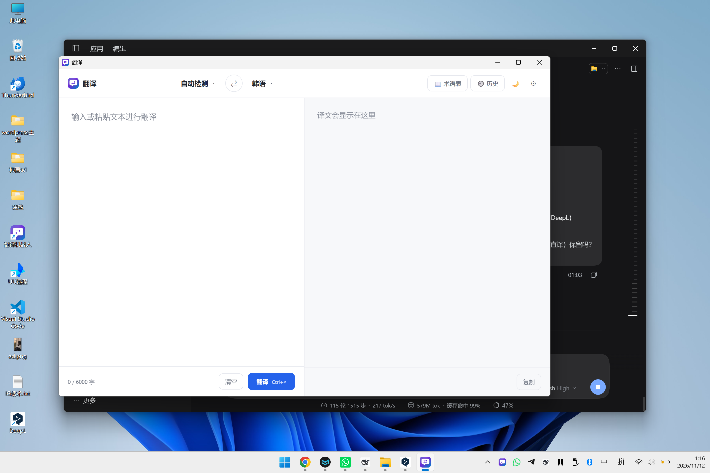

# 翻译

一个小而快的 Windows 桌面翻译工具：左边输入，右边出译文，只用大模型 API 翻译。



## 特点

- **两栏即用**：粘贴文本 → 点「翻译」（或 `Ctrl+Enter`），译文原地显示，一键复制
- **任意 OpenAI 兼容接口**：DeepSeek、OpenAI、通义、智谱、Gemini、Grok、OpenRouter、本地 Ollama…
- **术语表**：固定品牌名/行业词的译法，翻译时强制生效
- **历史记录**：本地保存最近 100 条，点击回填重译
- **缓存**：重复内容秒回，不重复计费
- **浅色/深色**：一键切换，选择本地记住
- **自动更新**：GitHub Releases + minisign 签名校验

没有账号、没有登录、没有订阅——填一个 API Key 就能用。

## 使用

1. 安装后打开，点右上角 ⚙
2. 填写服务商地址、API Key、模型名（例如 `https://api.deepseek.com/v1` / `deepseek-chat`）
3. 点「测试连接」确认可用，保存
4. 回到主界面输入文本，点「翻译」

## 快捷键

| 快捷键 | 作用 |
|---|---|
| `Ctrl+Enter` | 翻译 |
| `Esc` | 关闭面板/抽屉 |

## 配置

配置文件位于 `%LOCALAPPDATA%\TranslatorBot\config.yaml`，也可从 `config.example.yaml` 复制后修改。

```yaml
models:
  - id: deepseek
    name: DeepSeek
    base_url: https://api.deepseek.com/v1
    api_key: sk-...
    model: deepseek-chat
    default: true

languages:
  mine: zh
  partners: [ko, ja, en]

features:
  default_tone: natural   # natural | formal | casual | literal
  cache: true
  glossary: true

proxy: ""                 # 可选，例如 http://127.0.0.1:7890
```

## 构建

前置：Rust stable、Node（仅用于语法检查，可选）。

```powershell
# 只编译 exe
powershell -ExecutionPolicy Bypass -File .\build-host.ps1 -NoBundle

# 完整安装包（需要 NSIS，由 Tauri 自带）
powershell -ExecutionPolicy Bypass -File .\build-host.ps1
```

产物：

- `dist\TranslatorBot\TranslatorBot.exe`
- `dist\翻译机器人_<版本>_x64-setup.exe`

发布由 GitHub Actions 完成：推 `v*` 标签后自动构建、签名、生成 `latest.json` 并发布 Release。

## 项目结构

```
host-tauri/
  src/
    main.rs        窗口、托盘、单实例、自动更新、命令注册
    commands.rs    Tauri 命令（配置/翻译/术语表/历史/模型测试）
    config.rs      配置读写
    db.rs          SQLite（缓存、术语表、历史、用量）
    provider.rs    OpenAI 兼容接口调用
    translator.rs  翻译编排与输出清洗
    prompts.rs     提示词模板
    languages.rs   语言表与语种识别
  web/             前端（原生 HTML/CSS/JS，无构建步骤）
assets/            图标
```

## 说明

- 本地数据（配置、缓存、历史）在 `%LOCALAPPDATA%\TranslatorBot\`，卸载不会删除，便于升级保留
- 2026-11 之前的版本是 Telegram 翻译机器人；现已重构为纯桌面翻译工具，旧版本仍保留在 Releases 中
